# AmigaEmulator

[](LICENSE) [](#installation-and-rom-setup) [](#building-and-testing)

A Commodore Amiga emulator written in C#/.NET, with a WinForms/SharpPixels
frontend, Paula stereo audio, floppy and hard disk emulation, savestates,
and encrypted network play.

This is the sister project of [C64Emulator](https://github.com/n1k0m0/C64Emulator).
Both use the author's SharpPixels rendering library and the same settings
navigation and remote-play design. The Amiga frontend adds its own dark panels,
gold borders, mouse capture and model-specific hardware settings.
Development combines hands-on emulator work with AI-assisted tooling.

[Screenshots](#screenshots) · [Getting started](#installation-and-rom-setup) · [Models](#machine-models-and-compatibility) · [Controls](#controls) · [Network play](#network-play) · [Build](#building-and-testing)

**Highlights:**

- **Eight machine profiles** — A500, A500+, A600, A2000 OCS/ECS, A1200,
  A3000/030 and A4000/030, with model-specific ROM and memory selection.
- **Real hardware execution** — Motorola 68000/020/030 integer cores,
  OCS/ECS and an AGA subset, Copper, Blitter, DMA, CIA and Paula.
- **Games and Workbench** — load your own ADFs, create a bootable HDF,
  and install your own AmigaOS/Workbench disks.
- **Flexible display** — sharp pixels, CRT/TV filters, six upscaler choices,
  fullscreen, aspect-preserving display or full-screen stretching.
- **Savestates and input** — screenshot previews, reset/restore,
  keyboard, relative mouse input and host gamepads.
- **Network play** — host-streamed video/audio, local client upscaling,
  observers, a second joystick, or complete control handover.
- **Windows setup and updates** — an Inno Setup installer and a
  GitHub Releases update system.

**Active development:** A500 is the primary target; additional models are
compatibility previews. See [model support](#machine-models-and-compatibility)
for implemented hardware and current limits. **Kickstart ROMs, AmigaOS,
Workbench and games are supplied by the user and are never bundled or downloaded.**

## Screenshots

Click any image to view it at full size.

| Kickstart 1.3 · A500 | AmigaOS 3.1.4 · A4000/030 | Shell and Clock · A4000/030 |
| --- | --- | --- |
| <a href="docs/screenshots/kickstart-13.png">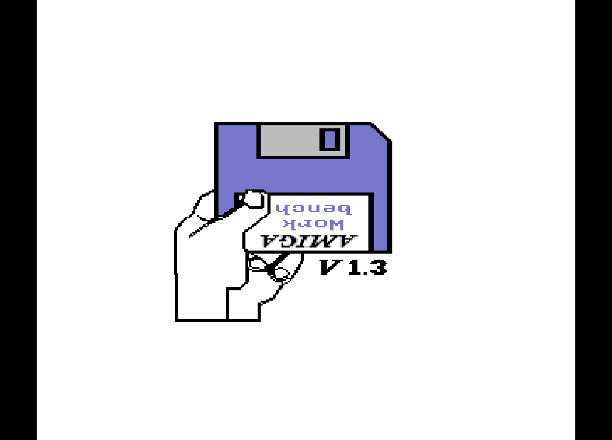</a> | <a href="docs/screenshots/workbench-desktop.png">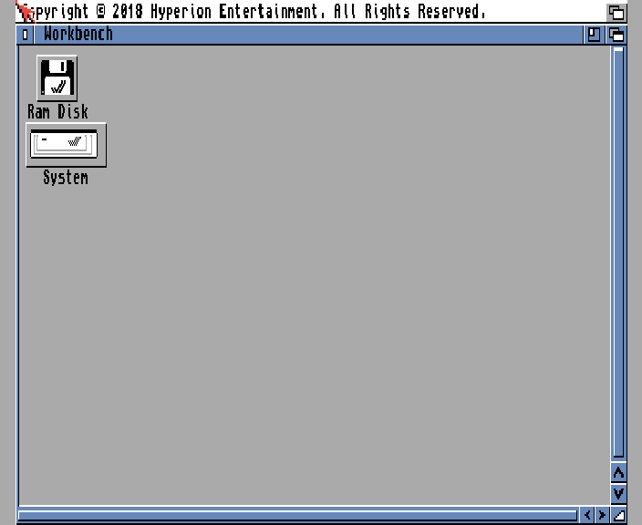</a> | <a href="docs/screenshots/workbench-shell-clock.png">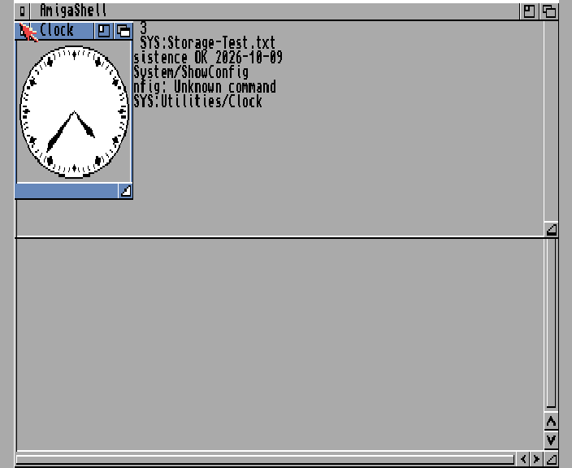</a> |

| Main menu | Settings hub | Graphics and upscaling |
| --- | --- | --- |
| <a href="docs/screenshots/main-menu.png">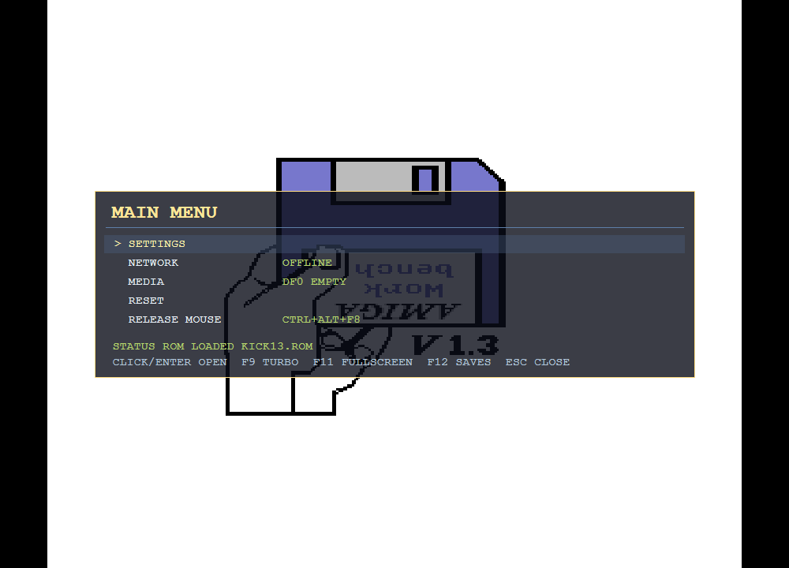</a> | <a href="docs/screenshots/settings-menu.png">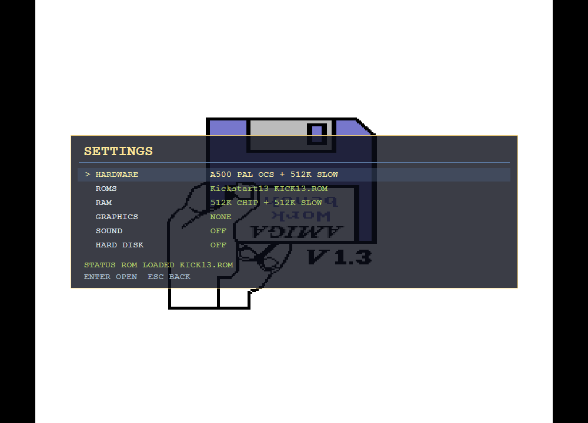</a> | <a href="docs/screenshots/graphics-menu.png">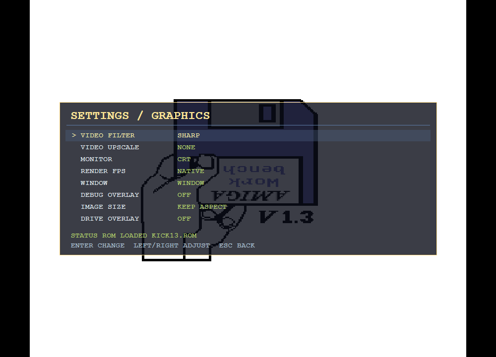</a> |

| Hardware | Network play | Hard disk configuration |
| --- | --- | --- |
| <a href="docs/screenshots/hardware-menu.png">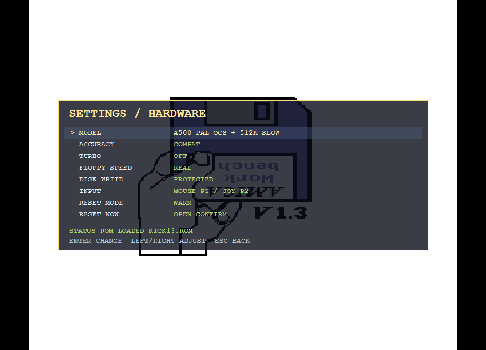</a> | <a href="docs/screenshots/network-menu.png">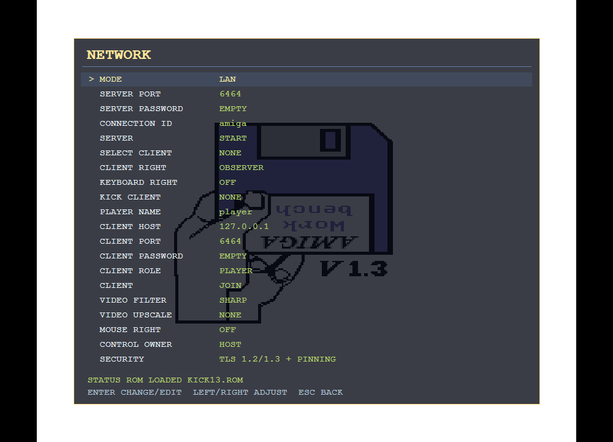</a> | <a href="docs/screenshots/hard-disk-menu.png">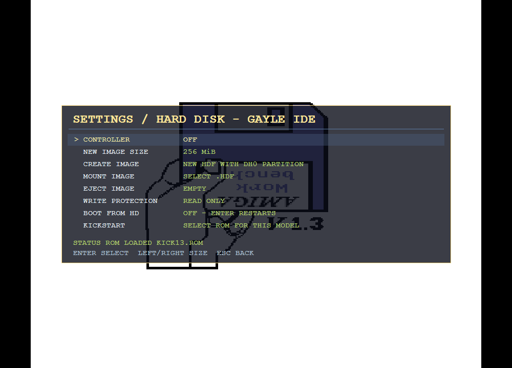</a> |

| The Settlers / Die Siedler · A500+ | Mega lo Mania · A500 | Cannon Fodder · A500 |
| --- | --- | --- |
| <a href="docs/screenshots/the-settlers.png">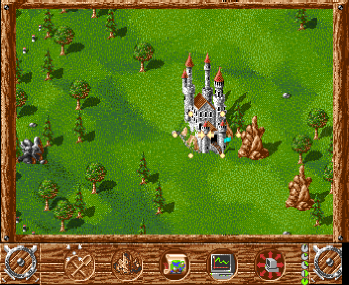</a> | <a href="docs/screenshots/mega-lo-mania.png">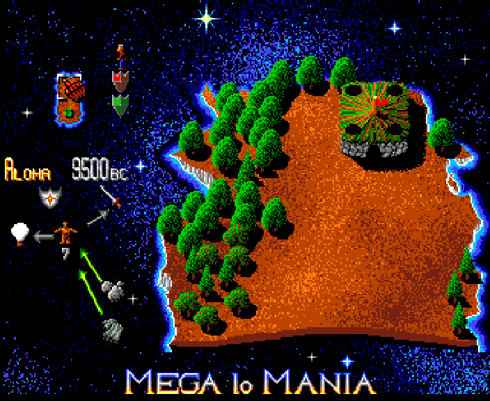</a> | <a href="docs/screenshots/cannon-fodder.png">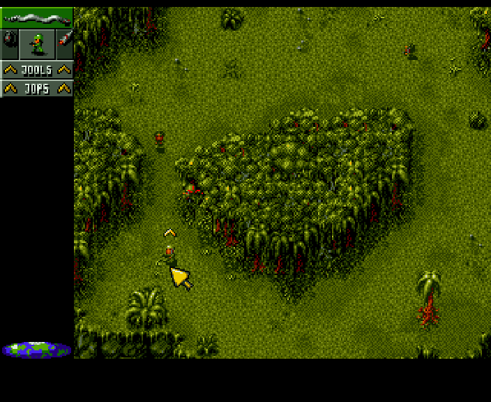</a> |

| Pinball Fantasies · A3000 | Desert Strike · A2000 ECS | Speedball · A500 |
| --- | --- | --- |
| <a href="docs/screenshots/pinball-fantasies.png">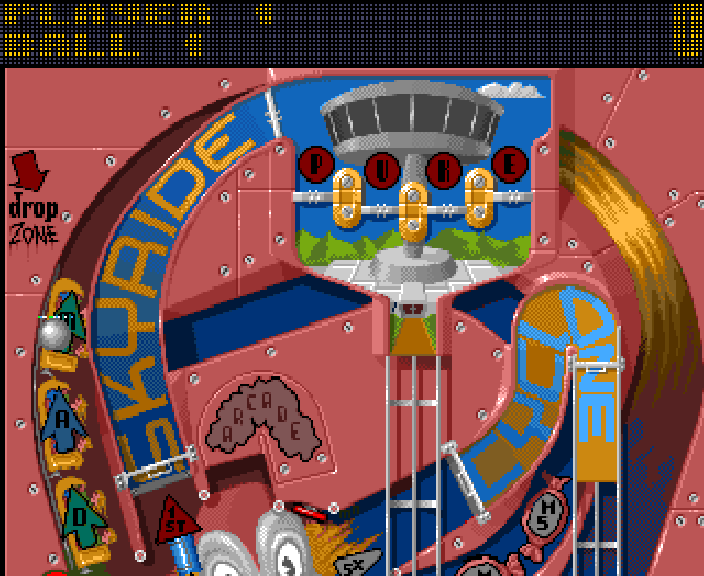</a> | <a href="docs/screenshots/desert-strike.png">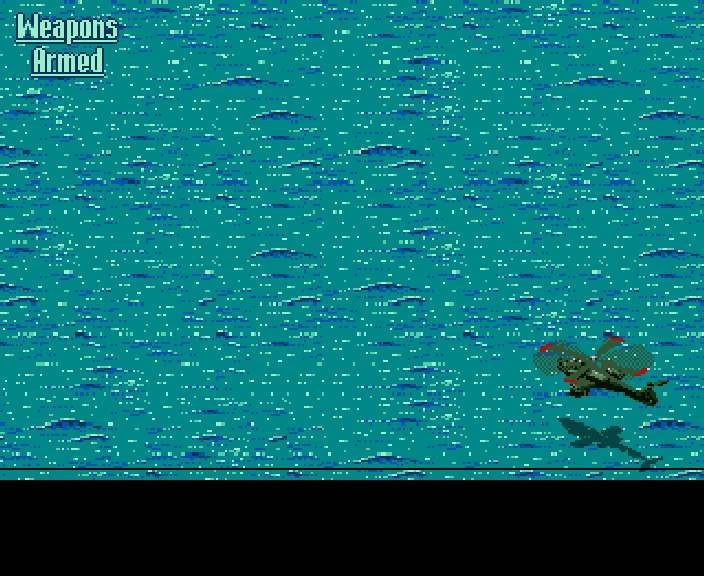</a> | <a href="docs/screenshots/speedball.png">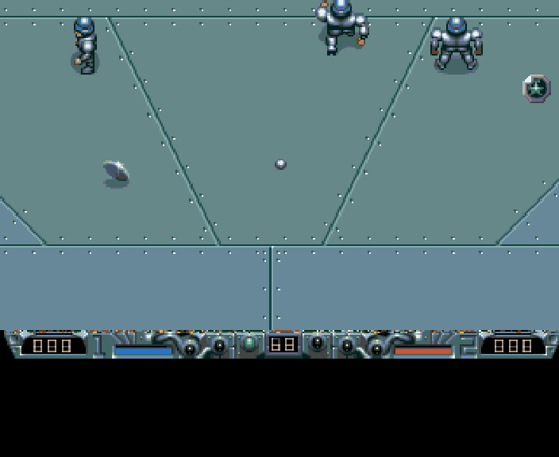</a> |

Game and Workbench pictures are captures from emulator validation runs.
The Kickstart and menu views were rendered through the current frontend code
with an isolated profile. Game captures use nearest-neighbor pixel aspect
correction; their contents are unchanged. These scenes illustrate tested
situations, rather than certify entire games or campaigns.
[Capture details and image rights](docs/screenshots/README.md).

## Installation and ROM setup

Use a Windows x64 setup from [GitHub Releases](https://github.com/n1k0m0/AmigaEmulator/releases)
when one is published. **No release is published as of 2026-10-11.**
For the current development version, [build from source](#building-and-testing)
or [build the installer](#windows-installer-and-updates).

1. Start the emulator with your own Kickstart ROM available.
2. If the selected model's ROM is missing, a dialog asks for your ROM file
   or folder. The external path is remembered. Cancelling or selecting no
   usable ROM closes startup cleanly.
3. Open `F10` → `SETTINGS` → `HARDWARE` to select a machine, then use
   `ROMS` and `RAM` to configure matching firmware and memory.
4. Open `F10` → `MEDIA`, choose a target drive and mount your ADF.
   Dropping an ADF onto the emulator window also mounts it.

Use Kickstart 1.3 for the main A500 target. Later machines need firmware
appropriate to their motherboard and storage controller. A generic ROM that
boots on another board is a separate compatibility case.

| User data | Default location |
| --- | --- |
| Kickstart ROMs | `%APPDATA%\AmigaEmulator\roms` or your selected external folder |
| Settings | `%APPDATA%\AmigaEmulator\settings.json` |
| Savestates | `%APPDATA%\AmigaEmulator\saves` |
| Hard disk images | `%APPDATA%\AmigaEmulator\harddisks` |
| Default floppy media folder | `%USERPROFILE%\Documents\AmigaEmulator` |

Keep ROMs, games, OS disks and hard disk images outside the source checkout.
They are not covered by the source-code license.

## Current features

- PAL-oriented machine timing, Motorola 68000/020/030 integer execution,
  implemented 020/030 caches and a 68030 MMU path.
- OCS custom-chip emulation, ECS extensions, and an AGA subset with
  256-color palette, eight bitplanes, HAM8, wider DMA and sprites.
- Copper, Blitter, bitplanes, sprites, bus arbitration, CIA 8520 timers,
  interrupts, keyboard, relative mouse and joystick input.
- Paula four-channel stereo audio with selectable output/LED filter profiles.
- Standard 880 KiB AmigaDOS ADFs, emulated MFM track streams, four floppy
  slots (`DF0`–`DF3`), disk changes, write protection and sector persistence.
- File-backed hard disks: Gayle IDE on A600/A1200, WD33C93/Super DMAC SCSI
  on A3000, and A4000 IDE wiring.
- Selectable Chip/Slow/Fast RAM, Zorro II Autoconfig on appropriate profiles,
  motherboard Fast RAM on A3000/A4000 and A600/A1200 PCMCIA SRAM.
- Savestates with preview images and emulated machine/controller state.
- `SHARP`, `CRT` and `TV` presentation filters; `NONE`, `SCALE2X`,
  `SCALE3X`, `HQ2X`, `HQ3X` and `HQ4X` upscalers.
- Encrypted LAN and relay remote play with host-managed input permissions.
- Regression tests and scripted gameplay scenarios for real boot, input,
  disk changes, reset, restore and storage persistence.

## Machine models and compatibility

| Profile | CPU / chipset | Model-specific hardware and status |
| --- | --- | --- |
| A500 | 68000 / OCS | Primary target; Kickstart 1.3 and Chip/Slow/Zorro II Fast RAM. |
| A500+ | 68000 / ECS | Preview; ECS, 1/2 MiB Chip RAM and battery clock. |
| A600 | 68000 / ECS | Preview; Gayle IDE and PCMCIA SRAM. |
| A2000 OCS | 68000 / OCS | Preview; revision-specific Chip/Slow RAM and Zorro II Fast RAM. |
| A2000 ECS | 68000 / ECS | Preview; ECS RAM layout, optional 2 MiB Chip upgrade and Zorro II Fast RAM. |
| A1200 | 68EC020 / AGA subset | Preview; Gayle IDE, PCMCIA SRAM and expansion Fast RAM. |
| A3000 | 68030 / ECS | Preview; motherboard Fast RAM, SCSI/Super DMAC and Ricoh clock. |
| A4000/030 | 68EC030 / AGA subset | Preview; motherboard Fast RAM, A4000 IDE and Ricoh clock. |

Model and RAM changes restart the guest. Menu options and saved configurations
are checked against each model's supported layouts.

The reviewed 2026-10-11 build passes **335 regression tests**. The expanded
**268-case / 30-title / eight-profile manifest** passes preflight validation;
this count does **not** mean 268 complete gameplay runs passed.
Real gameplay evidence and required configurations are recorded in
[the compatibility report](AmigaEmulator/Docs/GameModelCompatibility-2026-10-09.md)
and [the approved roadmap](AmigaEmulator/Docs/MachineModels.md#approved-roadmap-progress-2026-10-09).

Some titles need a specific RAM/ROM layout or an explicitly prepared copy of
their loader disk. For example, Mega lo Mania's reviewed 020/030 runs use a
guarded compatibility copy; Cannon Fodder's accepted first-mission runs use
three mounted data disks. Its single-drive disk-change path remains open.
Read [the gameplay runner guide](Tools/GameRunner/README.md) before reproducing
these configurations.

Remaining accuracy work includes ECS/AGA superhires and full interlace,
programmable display timing, cache/MMU timing and restartable faults,
custom loaders, later gameplay and disk transitions. **68881/68882 FPU,
A4000/040 and Zorro III are not implemented.** A2000 storage expansion boards
are also unfinished. Hardware and full-game compatibility stay under review.

## Controls

| Key / action | Function |
| --- | --- |
| `F9` | Toggle turbo mode. |
| `F10` | Open or close the main menu. |
| `F11` | Toggle fullscreen/windowed display. |
| `F12` | Open the savestate menu. |
| Click inside the Amiga image | Capture the mouse; this first click is consumed locally. |
| `Ctrl` + `Alt` + `F8` | Release the mouse. |
| `F10` → `RELEASE MOUSE` | Release the mouse through the main menu. |
| Arrow keys / mouse | Navigate overlay menus. |
| `Enter` | Activate the selected menu entry. |
| `Left` / `Right` | Adjust settings. |
| `Esc` | Return to the parent menu or close the main menu. |
| Mouse wheel | Scroll long menus. |
| Drop an ADF on the window | Mount it into the selected target drive. |

The mouse starts free and uses relative guest input after capture.
Menus retain capture inside the emulator window and show a pointer for
selection. Closing a menu resumes guest mouse control. Switching to another
window or minimizing releases capture; click the image again after returning.

## Main menu and settings

The `F10` overview contains `SETTINGS`, `NETWORK`, `MEDIA`, `RESET`
and `RELEASE MOUSE`. Local emulation pauses while an overlay menu is open.
The settings hierarchy matches the C64 frontend:

| Settings page | Configuration |
| --- | --- |
| `HARDWARE` | Machine model, accuracy profile, turbo, floppy speed/write protection and reset. Its `INPUT` submenu selects mouse/joystick port modes and gamepad input. |
| `ROMS` | Discover and select your local Kickstart ROMs. |
| `RAM` | Chip/Slow/Fast RAM and supported PCMCIA SRAM options. |
| `GRAPHICS` | Filter, upscaler, monitor aperture, render FPS, fullscreen, image size and overlays. |
| `SOUND` | Audio enable, volume and Paula output filter. |
| `HARD DISK` | Create/mount/eject HDFs, controller enable, write protection and hard disk boot. |

### Display and sound

`GRAPHICS` → `VIDEO UPSCALE` offers `NONE`, `SCALE2X`, `SCALE3X`,
`HQ2X`, `HQ3X` and `HQ4X`. Upscaling changes pixel reconstruction
without changing the displayed image size. `IMAGE SIZE = KEEP ASPECT`
preserves the presentation aspect ratio; `FILL SCREEN` stretches the image
to the entire window or fullscreen area. Monitor aperture and render FPS
are separate options. A higher render cap does not change native guest timing;
turbo mode runs the emulation faster.

`SOUND` offers `OFF`, `A500`, `A1200` and `LED` filter profiles.
`OFF` gives the clearest output; A500/A1200 follow the game's LED-filter
state, while LED forces the extra filtering on.
[Paula audio and filter details](AmigaEmulator/Docs/Audio.md).

## Network play

Open `F10` → `NETWORK`. The host runs the Amiga and streams completed
native frames plus Paula audio. Connected clients suspend their local Amiga,
show the host stream and send only host-approved input. Leaving resumes the
client's parked machine. Video presentation, upscaling, fullscreen and sound
settings remain local to each viewer.

### LAN

1. Host: choose `MODE = LAN`, set `SERVER PORT` and an optional
   `SERVER PASSWORD`, then start the server.
2. Client: enter the host's `CLIENT HOST`, matching `CLIENT PORT`
   and password, choose a player name, then join.
3. Host: select the connected client and grant joystick, keyboard or mouse
   permissions, or use `CONTROL OWNER` to hand over all guest controls.

Clients initially join as observers. The host can grant the second joystick
for multiplayer, individual input devices or exclusive full control.
Configure two joystick ports under `HARDWARE` → `INPUT` when the game needs
two joysticks. Revocation or disconnect releases held remote inputs.

### Relay

Choose `MODE = RELAY` on both sides and use the same relay address, port,
connection ID and relay password. The default relay port is `6465`.
The included relay supports both C64 and Amiga rooms on the same listener,
with separate emulator namespaces. **An existing C64-only proxy must be
upgraded to this shared relay before it can accept Amiga connections.**
See [relay installation and proxy migration](relay_server/README.md).

| Area | Transport |
| --- | --- |
| Security | TLS 1.2/1.3 with SHA-256 certificate pinning; changed pins require explicit acceptance. Relay sessions add end-to-end ECDH P-256 / AES-256-GCM encryption. |
| Video | Native unfiltered ARGB32, retaining HAM/AGA/raster colors; smallest full, compressed, sparse or XOR/RLE delta payload. Scaling and overlays are local. |
| Audio | Stereo IMA ADPCM packets with a PCM fallback; local output filters follow the host game's LED state. |
| Flow control | Latest pending video frame and bounded audio queues so a slow client does not stall others. |
| Permissions | Observer, joystick ports, keyboard, one mouse owner or complete control handover. |
| Protocol | Six-byte `AMIGAR` identity, based on the C64 transport design. |

The Windows installer does not install a relay service. Deploy it separately
if needed. [Full network, security and wire-format documentation](AmigaEmulator/Docs/NetworkPlay.md).

## Hard disks and memory expansions

Open `F10` → `SETTINGS` → `HARD DISK`. Choose `NEW IMAGE SIZE`
(16–2048 MiB), then `CREATE IMAGE` and a new `.hdf` filename.
The emulator creates a whole-disk image with an RDB and bootable DH0 FFS
partition. Format DH0 and install your own OS from your Workbench/AmigaOS disks.
Creation preserves existing files.

`MOUNT IMAGE` opens a raw whole-disk/RDB HDF. Partition-only HDFs,
VHD/HDZ containers and host directories are not translated.
`WRITE PROTECTION` selects read-only or writable access.
Completed sector writes persist; ejecting, reconfiguring, saving or closing
flushes the image. Controller/image/access-mode changes restart the guest.
`BOOT FROM HD` enables hard disk boot and ejects floppy media for that session.

Select firmware matching the board and controller. A500 Kickstart 1.3 does
not provide the Gayle IDE driver used by the optional legacy expansion.
User-provided AmigaOS 3.1.4 on A4000/030 has passed basic desktop, Shell/Clock,
restart/restore and file-persistence checks; this is not full OS certification.
[Storage validation](AmigaEmulator/Docs/StorageExpansion.md).

## Savestates

`F12` opens save/load with screenshot previews. Savestates preserve the
machine model, CPU/chip/RAM state, input and mounted controller state.

**An HDF remains an external mutable file. Loading a savestate does not
rewind hard disk contents.** Keep images alongside their saves and make a
separate image copy when a disk snapshot is needed.

## Windows installer and updates

The installer follows the C64 project's Inno Setup / GitHub Releases design.
It contains the Windows x64 runtime and excludes ROMs, OS disks, games and saves.

```powershell
./scripts/build-installer.ps1
```

Output: `artifacts/installer/AmigaEmulator-<version>-win-x64-setup.exe`
and a SHA-256 checksum. Building setup requires Inno Setup 6.

GUI startup checks GitHub Releases in the background. When a newer release is
available, it offers the setup download with progress, cancellation and retry.
Installation closes the emulator cleanly before launching setup.
Updates and uninstall preserve user ROMs, saves and hard disks.

The root [VERSION](VERSION) controls application and setup versions.
A matching `v*` tag builds, tests and publishes Windows assets through
[the release workflow](.github/workflows/release.yml).
[Installation, update and release details](AmigaEmulator/Docs/InstallationAndUpdates.md).

## Building and testing

Requirements: Windows x64 and the .NET 10 SDK. Visual Studio with the .NET
desktop workload is optional. Running the emulator also requires your own ROM.

```powershell
dotnet build .\AmigaEmulator.sln -c Release -p:Platform=x64
.\AmigaEmulator\bin\x64\Release\AmigaEmulator.exe
```

Or start directly:

```powershell
dotnet run --project .\AmigaEmulator\AmigaEmulator.csproj -c Release -p:Platform=x64
```

Run the source regression suite:

```powershell
dotnet run --project .\AmigaEmulator.Tests -c Release -p:Platform=x64
```

Use Release builds for normal gameplay and performance measurements.
For real-media scenarios, gameplay acceptance and paired measurements, see
[GameRunner](Tools/GameRunner/README.md), [test specifications](AmigaEmulator/Docs/TestSpecs/README.md)
and [the machine roadmap](AmigaEmulator/Docs/MachineModels.md).

## Repository layout

```text
AmigaEmulator/          Application, CPU, custom chips, storage, input and frontend
AmigaEmulator.Tests/    Source regression runner
SharpPixels/           Pixel presentation, filters and upscaling
Tools/                 Gameplay/CPU/audio runners and compatibility scripts
docs/screenshots/      GitHub gallery and capture notes
installer/             Inno Setup project
scripts/               Installer build and validation
relay_server/          Shared C64/Amiga TLS relay and service helpers
external-tests/        Third-party hardware test sources and licenses
```

## License

The emulator source is licensed under the [Apache License 2.0](LICENSE).
Bundled HQx and devtest sources retain their own licenses; see
[THIRD-PARTY-NOTICES.md](THIRD-PARTY-NOTICES.md) and
[the devtest license](external-tests/amiga_devtest/LICENSE).

Kickstart, AmigaOS/Workbench, games and their screenshot artwork retain
their respective owners' rights. They are not covered by the emulator's
source-code license.
